<div align="center">



# 🎬 Awesome AI Video Enhancement

### Curated Ecosystem of State-of-the-Art SaaS Platforms & Open-Source Deep Learning Pipelines

<p align="center">
  <a href="https://github.com/ishandutta2007/Awesome-Awesome-Awesome"></a>
  <a href="https://discord.gg/jc4xtF58Ve"></a>
  <a href="https://github.com/ishandutta2007/Awesome-AI-Video-Enhancement/stargazers"></a>
  <a href="https://github.com/ishandutta2007/Awesome-AI-Video-Enhancement/network/members"></a>
  <a href="https://github.com/ishandutta2007/Awesome-AI-Video-Enhancement/pulls"></a>
  <a href="LICENSE"></a>
  <a href="https://github.com/ishandutta2007"></a>
</p>

<p align="center">
  <strong>A comprehensive index tracking the bleeding edge of AI Video Super-Resolution (VSR), Video Frame Interpolation (VFI), Real-Time Video Restoration (RVR), Diffusion Transformers (DiT), and Temporal Consistency.</strong>
</p>

---

</div>

## 📌 Overview & SEO Insights

**AI Video Enhancement** is a rapidly evolving subfield of computer vision and generative deep learning. Modern pipelines transcend traditional spatial filters by predicting temporal motion vectors, removing heavy compression degradation, hallucinating photorealistic high-frequency details, synthesizing intermediate frames for fluid slow motion, and stabilizing frame-to-frame coherence to eliminate temporal flickering and shimmering.

Whether you are an archivist revitalizing analog film, a video creator upscaling anime or 4K/8K content, or a machine learning engineer engineering self-hosted inference servers, this directory gathers both commercial SaaS services and community-driven open-source projects.

---

## 📑 Table of Contents

- [📊 Sector Overview & Market Dynamics](#-sector-overview--market-dynamics)
- [💼 SaaS & Hosted Commercial Platforms](#-saas--hosted-commercial-platforms)
- [🚀 Open-Source GitHub Projects](#-open-source-github-projects)
- [🧩 Pipeline Architecture & Frameworks](#-pipeline-architecture--frameworks)
- [🤝 How to Contribute](#-how-to-contribute)
- [⭐ Star History](#-star-history)
- [💖 Support & Community](#-support--community)
- [⚠️ Technical Disclaimer](#️-technical-disclaimer)

---

## 📊 Sector Overview & Market Dynamics

The global **AI Video and Creative AI Enhancement** sector is projected to expand from **$4.6 billion to over $5.5 billion in 2025–2026**, registering a Compound Annual Growth Rate (**CAGR**) between **18.8% and 33.7%** through the early 2030s as enterprise video creation, streaming services, and social content pipelines rapidly transition to generative upscaling.

From a structural perspective, the market is **moderately fragmented** rather than a winner-take-all monopoly: while mega-cap tech conglomerates and established creative suites (e.g., ByteDance's CapCut, Adobe via Topaz Labs) command enormous mass-market distribution, specialized prosumer vendors (Runway, Descript, Bending Spoons) and lightweight niche utilities retain strong developer loyalty. Simultaneously, a hyperactive **open-source ecosystem** (Real-ESRGAN, BasicSR, SeedVR, SwiftVR) continuously democratizes breakthrough diffusion and windowed-attention models, driving rapid commercial innovation and giving studios self-hosted independence.

---

## 💼 SaaS & Hosted Commercial Platforms

Below is the structured overview of commercial AI video enhancement and upscaling platforms, **ranked in descending order by company scale** (estimated market valuation and annual revenues).

| Platform / Tool | Developer / Company | Company Scale (Valuation / Revenue) | Starting Tier Price | Free Tier & Trial Limits | Primary Capabilities & Core Models |
| :--- | :--- | :--- | :--- | :--- | :--- |
| 🎬 **[CapCut](https://www.capcut.com/)** | ByteDance | **~$550B Valuation**<br>• ~$186B Annual Revenue (2025) | **$9.99 / month** (Standard Mobile)<br>• Pro: $19.99 / mo ($179.99 / yr) | **Forever-free plan available**:<br>• Free 1080p exports without watermarks on standard tools<br>• Watermarks applied only if Pro templates/effects are used<br>• Capped monthly quotas for auto-captions and AI tools | Cloud and cross-platform NLE with AI upscaling, optical flow slow-motion, background subtraction, and auto reframe. |
| 📱 **[Remini](https://remini.ai/)** | Bending Spoons | **~$18.0B – $19.6B Market Cap**<br>• ~$1.31B Annual Revenue (2025) | **$4.99 / week** (Lite Mobile)<br>• Pro Web/App: $9.99 / month | **Freemium plan available**:<br>• Up to 5 free photo/video enhancements per day supported by mandatory video ads<br>• Resolution output caps and queue delays on free mode<br>• 7-day free trial on weekly subscriptions | Deep learning facial reconstruction, unblurring, compression cleanup, and high-frequency portrait restoration. |
| ⚡ **[Runway](https://runwayml.com/)** | Runway AI, Inc. | **~$5.3B Valuation** (Series E, Feb 2026)<br>• $200M+ ARR | **$12.00 / month** (Billed annually at $144/yr)<br>• $15.00 / month billed monthly | **One-time free trial tier**:<br>• 125 non-renewable starter credits upon registration (no monthly refresh)<br>• Exports limited to 720p with a Runway watermark<br>• 5 GB cloud asset storage | Generative Gen-3/Gen-4 diffusion models, motion brush, optical flow interpolation, inpainting, and video upscaling. |
| 🎞️ **[Wondershare Filmora](https://filmora.wondershare.com/)** | Wondershare Technology Group | **~$1.4B Market Cap** (SZSE: 300624)<br>• ~$215M Annual Revenue | **$49.99 / year** (Annual Plan)<br>• $79.99 Perpetual license | **Indefinite free evaluation plan**:<br>• Full access to editing timeline and basic AI tools indefinitely<br>• All exported videos contain a prominent full-width Filmora watermark<br>• No commercial license and advanced AI credits are locked | Prosumer video suite featuring AI video upscaling, smart frame interpolation, audio denoise, and AI auto-reframing. |
| 🎙️ **[Descript](https://www.descript.com/)** | Descript, Inc. | **~$550M Valuation** (Series C)<br>• ~$55M ARR | **$16.00 / month** (Billed annually at $192/yr)<br>• $24.00 / month billed monthly | **Forever-free plan available**:<br>• 60 media minutes (1 hour) per month transcription/import (max 1 GB/file)<br>• Local exports capped at 720p with a Descript watermark<br>• 100 non-renewing one-time AI credits; 5 GB storage | Text-based video/audio editor with Studio Sound AI voice isolation, automatic filler-word removal, and video upscaling. |
| 💎 **[Topaz Video AI](https://www.topazlabs.com/topaz-video-ai)** | Topaz Labs *(Acquired by Adobe)* | **~$200M – $300M Est. Valuation**<br>• ~$35M – $50M ARR | **$59.00 / month** (Flexible monthly)<br>• $299.00 / year (Personal license) | **Free evaluation trial mode**:<br>• Unlimited in-app preview rendering across all AI models locally<br>• Exported video files carry a prominent diagnostic watermark<br>• Offers a 48-hour money-back guarantee on paid plans | Industry benchmark desktop engine with Proteus, Iris, Nyx, Rhea, and Artemis models for upscaling, deinterlacing, and frame interpolation. |
| ✂️ **[Cutout.pro](https://www.cutout.pro/)** | LibAI Tech Ltd. | **Bootstrapped / Private**<br>• ~$10M – $25M Annual Revenue | **$5.00 / month** (80 credits/month)<br>• $4.99 one-time pack (30 credits) | **Freemium plan available**:<br>• 5 free one-time credits provided upon account creation<br>• Unlimited free web previews at low resolution<br>• Additional free credits via user referral program | API-first visual design platform with video background removal, anime enhancement, and video resolution boosting. |
| 🔬 **[AVCLabs Video Enhancer](https://www.avclabs.com/)** | Anvsoft Inc. | **Bootstrapped / Private**<br>• ~$5M – $10M Est. Revenue | **$39.95 / month** (1-month license)<br>• $119.95 / year (or $199.90 lifetime) | **Free trial evaluation plan**:<br>• 3 free video export conversions allowed<br>• Exports are strictly capped at 30 seconds maximum length<br>• Includes embedded AVCLabs software watermark | Multi-model enhancement suite with facial recovery, frame interpolation, noise reduction, and SDR-to-HDR colorization. |
| 🐾 **[HitPaw VikPea](https://www.hitpaw.com/)** | HitPaw Co., Ltd. | **Bootstrapped / Private**<br>• ~$1.2M Est. ARR | **$42.99 / month** (1-month plan)<br>• $99.99 / year (or $284.69 lifetime) | **Free trial preview mode**:<br>• Unlimited real-time split-screen preview of all AI models on your own video<br>• Zero clean video exports without purchasing a plan (exporting triggers upgrade paywall) | Desktop batch video enhancer with specialized anime models, face reconstruction, colorize algorithms, and low-light enhancement. |
| 🖼️ **[Deep-Image.ai](https://deep-image.ai/)** | Deep-Image Sp. z o.o. | **Seed-backed** ($189K raised)<br>• ~$900K Est. ARR | **$9.00 / month** (100 credits/month)<br>• Pay-as-you-go credit packs available | **Freemium trial plan**:<br>• 5 to 10 free trial credits upon email registration (no credit card required)<br>• Free tier processed outputs include a platform watermark<br>• Unused paid credits roll over up to 3 months | Cloud and API image/video restoration platform for automatic upscaling, de-blurring, artifact cleaning, and background removal. |

---

## 🚀 Open-Source GitHub Projects

The open-source ecosystem provides transparent model weights, reproducible training scripts, and self-hosted inference pipelines without vendor lock-in. 

Entries below are **strictly ranked in descending order by GitHub stargazers count**.

---

### 1. [Upscayl](https://github.com/upscayl/upscayl) [](https://github.com/upscayl/upscayl/stargazers)
- **License**: `AGPL-3.0` | **Focus**: Cross-Platform AI Desktop Upscaling Framework
- **Overview**: The most popular open-source AI upscaler on GitHub. Built with Electron and ncnn-Vulkan, Upscayl delivers a zero-configuration GUI that runs on Linux, macOS, and Windows with Vulkan-compatible hardware (AMD, Intel, NVIDIA). While initially targeted at image enhancement, its batch pipelines and CLI backend allow efficient frame-by-frame video processing with Real-ESRGAN, Remacri, and custom models.

### 2. [GFPGAN](https://github.com/TencentARC/GFPGAN) [](https://github.com/TencentARC/GFPGAN/stargazers)
- **License**: `Apache-2.0` | **Focus**: Real-World Blind Face Restoration
- **Overview**: Developed by Tencent ARC, GFPGAN leverages rich facial component priors encapsulated within a pre-trained StyleGAN architecture to restore degraded and compressed facial details in video frames. It preserves eye gaze, skin texture, and mouth identity, making it the standard post-processing pass for archival and documentary video upscaling.

### 3. [Real-ESRGAN](https://github.com/xinntao/Real-ESRGAN) [](https://github.com/xinntao/Real-ESRGAN/stargazers)
- **License**: `BSD-3-Clause` | **Focus**: Practical Blind Super-Resolution Algorithms
- **Overview**: A landmark project in super-resolution that trains compact neural networks using high-order degradation modeling to tackle real-world blur, noise, and compression artifacts. Features the video-specific **AnimeVideo-v3** and **RealESRGAN_x4plus** models with standalone ncnn-Vulkan binaries for high-throughput GPU rendering.

### 4. [waifu2x](https://github.com/nagadomi/waifu2x) [](https://github.com/nagadomi/waifu2x/stargazers)
- **License**: `MIT` | **Focus**: Anime-Style Art & Video Upscaling via Deep Convolutional Networks
- **Overview**: The pioneering deep learning project that popularized super-resolution in the creative community. Utilizes deep convolutional neural networks (SRCNN/VGG-style architectures) specifically optimized for line art, flat color fields, and noise elimination in 2D animation.

### 5. [Video2X](https://github.com/k4yt3x/video2x) [](https://github.com/k4yt3x/video2x/stargazers)
- **License**: `AGPL-3.0` | **Focus**: Automated Video Super-Resolution & Interpolation Orchestrator
- **Overview**: A full-featured pipeline orchestration tool for machine-learning video super-resolution and frame interpolation. Automates the full flow: stream extraction via FFmpeg → parallel frame upscaling (Real-ESRGAN, Real-CUGAN, Anime4K) → frame interpolation (RIFE) → audio/subtitle remuxing. Offers a modern Qt6 GUI and robust CLI.

### 6. [Anime4K](https://github.com/bloc97/Anime4K) [](https://github.com/bloc97/Anime4K/stargazers)
- **License**: `MIT` | **Focus**: Real-Time Shader-Based Anime Upscaling & Deblurring
- **Overview**: Ultra-high-speed set of open-source GLSL video shaders designed for real-time video playback inside media players like MPV, VLC, and MPC-HC. Can upscale 1080p anime to crisp 4K at 60+ FPS on modest hardware with virtually zero latency.

### 7. [CodeFormer](https://github.com/sczhou/CodeFormer) [](https://github.com/sczhou/CodeFormer/stargazers)
- **License**: `S-Lab License` | **Focus**: Robust Blind Face Restoration with Codebook Lookup Transformer
- **Overview**: Developed by S-Lab at NTU, CodeFormer formulates facial restoration as a discrete code prediction task. By learning codebook lookup priors inside a Transformer, it delivers superior facial fidelity and natural textures even under extreme degradation without over-smoothing.

### 8. [Waifu2x-Extension-GUI](https://github.com/AaronFeng753/Waifu2x-Extension-GUI) [](https://github.com/AaronFeng753/Waifu2x-Extension-GUI/stargazers)
- **License**: `GPL-3.0` | **Focus**: Multithreaded Desktop Video & Image Super-Resolution
- **Overview**: An extensive Windows desktop application integrating multiple backends (Waifu2x, Real-ESRGAN, Real-CUGAN, SRMD, Anime4K) with full hardware acceleration. Features automated batch processing, multi-GPU load balancing, and audio-video synchronization.

### 9. [BasicSR](https://github.com/XPixelGroup/BasicSR) [](https://github.com/XPixelGroup/BasicSR/stargazers)
- **License**: `Apache-2.0` | **Focus**: Open-Source Image & Video Restoration Research Toolbox
- **Overview**: The fundamental research toolbox underpinning many modern video super-resolution architectures. Houses implementations of EDSR, RCAN, SRResNet, SRGAN, ESRGAN, EDVR, BasicVSR, BasicVSR++, SwinIR, and DFDNet with modular PyTorch training and evaluation suites.

### 10. [MMagic (MMEditing)](https://github.com/open-mmlab/mmagic) [](https://github.com/open-mmlab/mmagic/stargazers)
- **License**: `Apache-2.0` | **Focus**: OpenMMLab Multimodal Advanced Generative & Editing Toolkit
- **Overview**: Comprehensive deep learning toolkit from OpenMMLab covering video super-resolution, video frame interpolation, video inpainting, and video matting. Implements research backends including BasicVSR, TOFlow, EDVR, and CAIN under a unified, production-grade PyTorch configuration system.

### 11. [ESRGAN](https://github.com/xinntao/ESRGAN) [](https://github.com/xinntao/ESRGAN/stargazers)
- **License**: `Apache-2.0` | **Focus**: Enhanced Super-Resolution Generative Adversarial Networks
- **Overview**: The landmark ECCV 2018 paper that established Residual-in-Residual Dense Blocks (RRDB) and relativistic GAN loss for photo-realistic super-resolution. Serves as the fundamental backbone for hundreds of community fine-tuned video models.

### 12. [Real-CUGAN (Bilibili AILab)](https://github.com/bilibili/ailab) [](https://github.com/bilibili/ailab/stargazers)
- **License**: `MIT` | **Focus**: AI Anime Super-Resolution with Artifact Reduction
- **Overview**: Bilibili's production-grade anime super-resolution model trained on massive animation datasets. Excels at removing blocky video compression artifacts while maintaining razor-sharp linework across 2x, 3x, and 4x scale factors.

### 13. [RIFE (ECCV2022-RIFE)](https://github.com/hzwer/ECCV2022-RIFE) [](https://github.com/hzwer/ECCV2022-RIFE/stargazers)
- **License**: `MIT` | **Focus**: Real-Time Intermediate Flow Estimation for Video Frame Interpolation
- **Overview**: The gold standard for open-source AI video frame interpolation (VFI). Uses IFNet to estimate intermediate motion flow fields directly, generating fluid slow-motion and 24fps-to-60fps/120fps video upsampling in real time.

### 14. [waifu2x-ncnn-vulkan](https://github.com/nihui/waifu2x-ncnn-vulkan) [](https://github.com/nihui/waifu2x-ncnn-vulkan/stargazers)
- **License**: `MIT` | **Focus**: Portable High-Performance Vulkan Implementation
- **Overview**: Standalone C++ binary utilizing Tencent's ncnn neural network framework and Vulkan compute shaders. Requires zero Python dependencies or CUDA installation, enabling fast frame processing across Intel, AMD, and NVIDIA hardware.

### 15. [VRT (Video Restoration Transformer)](https://github.com/JingyunLiang/VRT) [](https://github.com/JingyunLiang/VRT/stargazers)
- **License**: `Apache-2.0` | **Focus**: Video Super-Resolution, Deblurring, and Denoising Transformer
- **Overview**: Groundbreaking architecture combining parallel frame feature extraction and mutual self-attention across multiple temporal frames. Solves long-range temporal consistency challenges in video restoration.

### 16. [SeedVR & SeedVR2](https://github.com/ByteDance-Seed/SeedVR) [](https://github.com/ByteDance-Seed/SeedVR/stargazers)
- **License**: `Apache-2.0` | **Focus**: One-Step Diffusion Transformer Video Restoration
- **Overview**: ByteDance Seed's breakthrough diffusion transformer framework (accepted at ICLR). Restores degraded video and achieves temporal consistency in a single inference step via adaptive window attention and adversarial post-training.

### 17. [rife-ncnn-vulkan](https://github.com/nihui/rife-ncnn-vulkan) [](https://github.com/nihui/rife-ncnn-vulkan/stargazers)
- **License**: `MIT` | **Focus**: Cross-Platform Vulkan Port of RIFE Frame Interpolation
- **Overview**: High-speed, self-contained binary port of RIFE for frame rate multiplication (30fps → 60fps/120fps). Integrates easily into FFmpeg filterchains and video editing scripts without requiring a full Python runtime.

### 18. [BasicVSR++](https://github.com/ckkelvinchan/BasicVSR_PlusPlus) [](https://github.com/ckkelvinchan/BasicVSR_PlusPlus/stargazers)
- **License**: `Apache-2.0` | **Focus**: Video Super-Resolution with Second-Order Grid Propagation
- **Overview**: Award-winning recurrent framework (NTIRE winner) featuring second-order grid propagation and flow-guided deformable alignments, effectively sharing optical information across wide temporal windows.

### 19. [Free AI Video Upscaler](https://github.com/sb2702/free-ai-video-upscaler) [](https://github.com/sb2702/free-ai-video-upscaler/stargazers)
- **License**: `MIT` | **Focus**: Zero-Server In-Browser Upscaling via WebGPU & WebCodecs
- **Overview**: Client-side web application executing CNN super-resolution models directly inside the user's browser via WebGPU compute shaders and WebSR. Processes 250k+ monthly active users with zero server bandwidth costs and total data privacy.

### 20. [RVRT](https://github.com/JingyunLiang/RVRT) [](https://github.com/JingyunLiang/RVRT/stargazers)
- **License**: `Apache-2.0` | **Focus**: Recurrent Video Restoration Transformer
- **Overview**: Designed to minimize the massive VRAM footprint of full-attention video transformers. Employs guided deformable attention within recurrent blocks to achieve state-of-the-art video deblurring and super-resolution with realistic GPU memory usage.

### 21. [LTX2-ICEdit-Insight](https://github.com/joyfoxai/LTX2-ICEdit-Insight) [](https://github.com/joyfoxai/LTX2-ICEdit-Insight/stargazers)
- **License**: `Apache-2.0` | **Focus**: DiT-Based Video Super-Resolution & Watermark/Subtitle Inpainting
- **Overview**: Built on the LTX-2.3 audio-video foundation model. Operates in latent video space to perform degradation recovery, video super-resolution, and temporally stable watermark and subtitle removal without identity drift.

### 22. [SwiftVR (Real-Time Video Restoration)](https://github.com/H-oliday/SwiftVR) [](https://github.com/H-oliday/SwiftVR/stargazers)
- **License**: `Apache-2.0` | **Focus**: Real-Time Generative Streaming Video Restoration
- **Overview**: The first generative video restoration framework to achieve real-time 1080p streaming on consumer GPUs (~26 FPS on RTX 5090). Features mask-free shifted-window attention, Restoration-aware Autoencoder (ReAE), and causal chunk-wise streaming on the Wan2.2 backbone.

### 23. [iNNfer](https://github.com/victorca25/iNNfer) [](https://github.com/victorca25/iNNfer/stargazers)
- **License**: `GPL-3.0` | **Focus**: Neural Network Inference CLI for Video & Image Restoration
- **Overview**: Lightweight Python CLI tool tailored for batch frame inference. Supports modern ESRGAN, Real-ESRGAN, and NAFNet models with FP16 precision, tiled VRAM caching, and automatic FFmpeg streaming pipes.

### 24. [vs-rvrt](https://github.com/Lyra-Vhess/vs-rvrt) [](https://github.com/Lyra-Vhess/vs-rvrt/stargazers)
- **License**: `MIT` | **Focus**: VapourSynth Plugin for Recurrent Video Restoration Transformer
- **Overview**: Native VapourSynth filter implementation of RVRT. Enables non-linear editing scripts to perform high-grade video deblurring, denoising, and 4x super-resolution directly within standardized encoding pipelines.

### 25. [video-super-resolution](https://github.com/Alhamwis/video-super-resolution) [](https://github.com/Alhamwis/video-super-resolution/stargazers)
- **License**: `MIT` | **Focus**: Comparative PyTorch Super-Resolution Sandbox
- **Overview**: Educational and benchmark implementation showcasing comparative side-by-side performance between SRCNN, ESRGAN, and Real-ESRGAN on video clips.

---

## 🧩 Pipeline Architecture & Frameworks

To deploy an industrial-grade, self-hosted video enhancement pipeline, modern production workflows typically chain specialized models together:

```
Input Video (.mp4/.mkv)
       │
       ▼
 [ FFmpeg Demux ] ──> Split Video Stream & Audio / Subtitle Tracks
       │
       ▼
 [ Frame Processing ] ──> Temporal Windows (e.g., SeedVR2 / SwiftVR / RVRT)
       │                    └─ Removes flicker, noise & compression artifacts
       ▼
 [ Spatial Super-Res ] ──> Real-ESRGAN / BasicSR (2x / 4x detail hallucination)
       │
       ▼
 [ Face Restoration ] ──> GFPGAN / CodeFormer (Optional face bbox detection)
       │
       ▼
 [ Frame Interpolation] ──> RIFE (Motion vector estimation for 60fps/120fps)
       │
       ▼
 [ FFmpeg Remux ] ───> Encode (NVENC/AV1/HEVC) + Sync Original Audio & Subs
       │
       ▼
 Enhanced Output (.mp4)
```

---

## 🤝 How to Contribute

Contributions from developers, researchers, and creators are warmly welcomed! 

1. **Fork** the repository: `git checkout -b feature/add-new-model`
2. **Add / Edit** entries in `README.md`:
   - For SaaS tools: include verified pricing tier, exact free trial/forever-free limits, and company metrics.
   - For open-source tools: include the repository link, Stars_Badge `[](https://github.com/{owner}/{repo}/stargazers)`, license, and a concise technical summary.
3. Keep the open-source list sorted descending by Stars_Count.
4. **Submit a Pull Request** with a descriptive summary of your changes.

---

## ⭐ Star History

[](https://star-history.dera.page/#ishandutta2007/Awesome-AI-Video-Enhancement&type=date&legend=top-left)

---

## 💖 Support & Community

Thank you for visiting **Awesome AI Video Enhancement**! If this directory has helped your video engineering projects, research, or creative work, please consider supporting the project:

- ⭐ **Star this repository** to improve discoverability for the community.
- 🍴 **Fork and contribute** your favorite models and benchmark insights.
- 📢 **Share** with fellow video creators, engineers, and researchers on Twitter/X, Reddit, or Discord.
- ☕ **Sponsor the Maintainer**: Support ongoing curation, benchmark hosting, and open-source contributions via GitHub Sponsors:  
  👉 **[Sponsor on GitHub (https://github.com/sponsors/ishandutta2007)](https://github.com/sponsors/ishandutta2007)**

---

## ⚠️ Technical Disclaimer

- **Community Curated**: This list is independently maintained for educational, archival, and research purposes and does not represent an endorsement.
- **Temporal Flicker**: Independent frame-by-frame super-resolution can cause temporal shimmering across frames. Always prioritize temporally aware models (SeedVR, SwiftVR, RVRT) for continuous video production.
- **Hardware Demand**: Generative video diffusion models and recurrent transformers are VRAM-intensive. Ensure adequate hardware allocation (16 GB+ VRAM recommended for 4K workflows) or employ tiling controls.
